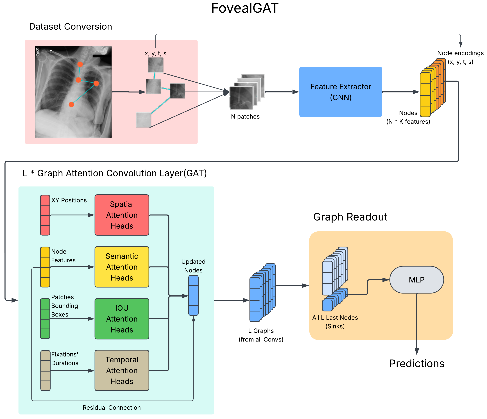

# FovealGAT: A Gaze Tracked Image is Worth a Graph of Foveal Patches



Chest X-Rays (CXRs) as a sequence of gaze fixations:
To the best of our knowledge, all multimodal machine learning models that use visual gaze data, use it to enrich the image. This, however, is not how our brains build the image's representation. We capture and interpret it via a sequence of eye fixations and movements.

So, in the interest of mimicking human reasoning, it seems logical to represent an image as a sequence of smaller patches, each captured by a fixation.

This work experiments with this concept in the specific context of chest x-rays.


The following steps explain each component of the workflow and architecture necessary to understand and replicate this experiment.

## 0 Setting up Environment

### 0.1 Obtain CXR Gaze Datasets

This work uses the [REFLACX](https://physionet.org/content/reflacx-xray-localization/1.0.0/) dataset. As it requires certification to be accessed, they have to be obtained from their original sources.

REFLACX uses a subset of CXRs from [MIMIC-CXR](https://physionet.org/content/mimic-cxr/2.0.0/), so it also needs to be downloaded for the original X-Rays.

### 0.2 Install Python Requirements

install [fovealgat requirements](./requirements.txt)

install [data conversion requirements](./data_convert_requirements.txt)

### 0.3 Relevant Data from Published Models

To check dataset splits for each fold of the models used for benchmarking in FovealGAT's paper, together with relevant training and model parameters, check the [Results Replication ReadMe](./results_replication/README.md).

## 1. Converting CXRs datasets to a gaze sequence

In order to run FovealGAT, we first need to convert regular CXR + Gaze datasets into Gaze Patch datasets. Each image needs to be transformed in a sequence of crops corresponding to the region of each gaze fixation.
[Dataset Conversion ReadMe](./gaze_dataset_convert/README.md)

## 2. Loading new datasets to torch dataset classes

After conversion, we need to load the newly created gaze patch datasets into pytorch datasets. [Pytorch Datasets ReadMe](./gaze_datasets/README.md)

## 3. Feature Extraction

We're using pretrained pyramid vision feature extraction, similar to GazeGNN and ViT. however, since we are working with small gaze patches, compared to the whole image, we need to limit the convolutions. Failing to do so, will try to extract features that need a larger size than the gazepatch can provide. [Feature Extraction ReadMe](./feature_extraction/README.md)

## 4. Adding encodings for sequence position, [X, Y], and fixation duration (t)

With 1X1 feature vectors representing each fixation gaze patch, we now need to add encodings for the fixation's (X, Y) position within the CXR and time duration. [Encodings ReadMe](./node_encodings/README.md)

## 5. FovealGAT

With the gaze patch features and encodings aggregated into graph nodes, we can feed it through our network. We'll go through each component. [FovealGAT ReadMe](./model/README.md)

### 5.1 GAT Layer

The first component is the Graph Attention Convolution Layer. [GAT Layer ReadMe](./model/README.md#gat_layer)

### 5.2 GazeGrapher

GazeGrapher is a module that aggregates several GAT layers in sequence, performing all graph convolutions before graph readout and prediction. [GazeGrapher ReadMe](./model/README.md#grapher)

### 5.3 Readout

Since we are dealing with complete causal graphs --each node sees ALL of its predecessors and itself-- we developed a causal graph readout. All information is aggregated by the last node at each convolution. So, we take the last node of each selected residual graph, concatenate them, and run them through a linear layer. [Readout ReadMe](./model/README.md#readout)

### 5.4 Whole pipeline

Since we now have all individual components, we are ready to run the full model. [Full Model ReadMe](./model/README.md#full)

## 6. Training

First thing is setting model and training parameters in [the configuration file](./fovealgat_confs.py)

load confs and instantiate model and hyper parameters


```python
import fovealgat_confs as conf
import os
```


```python
from feature_extraction.extractors import GazePatchFeatureExtractor
feat_ext = GazePatchFeatureExtractor(conf.fe_tail_feat_ext,
                                     conf.fe_state_dict_pth,
                                     conf.fe_channels,
                                     conf.fe_act,
                                     conf.fe_norm,
                                     conf.fe_bias,
                                     conf.fe_w_init_f,
                                     conf.device)
```


```python
from node_encodings.sequence import GazeSinCosPosEncoding
encoder = GazeSinCosPosEncoding(conf.reflacx_max_len if conf.dataset_type == 'reflacx' else conf.mimic_max_len,
                                conf.seq_encoding_feat_count)
```


```python
from model.gat_convs.gat_conv import CausalGATConv
from model.gat_convs.xyt_gat_conv import CausalXYTGATConv, CausalEuclideanTGATConv
from model.gat_convs.iou_xyt_gat_conv import CausalIOU_XYTGATConv, CausalIOU_EuclideanTGATConv
```


```python
def gat_args(gat_conv):
    if gat_conv == CausalGATConv:
        gat_conv_args={'channels': conf.grph_channels,
                    'act_att': conf.grph_act_att,
                    'act_gat': conf.grph_act_gat,
                    'norm': conf.grph_norm,
                    'dropout': conf.grph_dropout,
                    'bias': conf.grph_bias,
                    'w_init_f': conf.grph_w_init_f}
    elif gat_conv in (CausalXYTGATConv, CausalEuclideanTGATConv):
        gat_conv_args={'channels': conf.grph_channels,
                    'xy_heads_ratio': conf.grph_xy_heads_ratio,
                    't_heads_ratio': conf.grph_t_heads_ratio,
                    'act_att': conf.grph_act_att,
                    'act_gat': conf.grph_act_gat,
                    'norm': conf.grph_norm,
                    'dropout': conf.grph_dropout,
                    'bias': conf.grph_bias,
                    'w_init_f': conf.grph_w_init_f}
    elif gat_conv in (CausalIOU_XYTGATConv, CausalIOU_EuclideanTGATConv):
        gat_conv_args={'channels': conf.grph_channels,
                    'xy_heads_ratio': conf.grph_xy_heads_ratio,
                    't_heads_ratio': conf.grph_t_heads_ratio,
                    'iou_heads_ratio': conf.grph_iou_heads_ratio,
                    'act_att': conf.grph_act_att,
                    'act_gat': conf.grph_act_gat,
                    'norm': conf.grph_norm,
                    'dropout': conf.grph_dropout,
                    'bias': conf.grph_bias,
                    'w_init_f': conf.grph_w_init_f}
    return gat_conv_args

    
```


```python
gat_conv = CausalIOU_EuclideanTGATConv
gat_conv_args = gat_args(gat_conv)
```


```python
from model.foveal_gat import FovealGAT
model = FovealGAT(feat_ext,
                    encoder,
                    gat_conv,
                    conf.grph_res_seq,
                    conf.grph_layers,
                    conf.grph_output_gat_levels,
                    conf.grph_residual_gat_levels,
                    conf.grph_att_heads,
                    gat_conv_args,
                    conf.readout,
                    conf.ro_hidden_features,
                    conf.ro_out_channels,
                    conf.ro_hidden_act,
                    conf.ro_pred_act,
                    conf.ro_dropout,
                    conf.ro_norm,
                    conf.ro_bias,
                    conf.ro_w_init_f,
                    conf.device)
```


```python
from gaze_datasets import reflacx, mimic_eye

dataset_clss = (reflacx.ReflacxGazePatchDataset
                if conf.dataset_type == 'reflacx'
                else mimic_eye.MimicEyeGazePatchDataset)

dataset_pth = (conf.reflacx_gaze_dataset_pth
               if conf.dataset_type == 'reflacx'
               else conf.mimic_gaze_dataset_pth)

dataset = dataset_clss(dataset_pth,
                       conf.desired_label,
                       mode='train',
                       target_fixation_keys=(('x', 'y', 't')
                                             if not model.iou
                                             else ('t', 'x', 'y', 'top_left', 'bottom_right')),
                       train_val_test_split=conf.train_val_test_split,
                       transform=conf.transform)
```


```python
criterion = conf.criterion()
optimizer = conf.optimizer([{'params': [p for n, p in model.named_parameters() if 'feat_ext.tail' not in n],
                             'lr': conf.lr},
                             {'params': [p for n, p in model.named_parameters() if 'feat_ext.tail' in n],
                             'lr': conf.lr_pretrained}])
    
```


```python
from torch.utils.data import DataLoader
from gaze_datasets.dataset_tools import gaze_patch_dataset_collate
import torch
from datetime import datetime
```


```python
test_back_prop = True
```


```python
def debug_grads(model):
    for name, param in model.named_parameters():
        if param.requires_grad:
            if param.grad is None:
                print("{}: Missing Gradient!!!".format(name))
                continue
            print(f"{name:25} | Mean: {param.grad.mean().item():.6f} | Max: {param.grad.max().item():.6f} | Norm: {param.grad.norm().item():.6f}")
```


```python
min_val_loss = torch.inf
for epoch in range(1 if test_back_prop else conf.epochs):
    model.train()
    dataset.set_mode('train')
    loader = DataLoader(dataset,
                        batch_size=conf.batch_size,
                        collate_fn=gaze_patch_dataset_collate,
                        shuffle=True,
                        num_workers=conf.dl_num_workers,
                        pin_memory=True)
    running_loss = 0.0
    sample_count = 0
    for i, (splits, fixations, patches, labels) in enumerate(loader):
        optimizer.zero_grad()
        h = model((splits,
                   fixations.to(conf.device),
                   patches.to(conf.device),
                   labels.to(conf.device)))
        loss = criterion(h, labels.to(conf.device))
        running_loss += loss * len(splits)
        sample_count += len(splits)
        loss.backward()
        if test_back_prop:
            print("BATCH {}".format(i))
            debug_grads(model)
            print('\n\n')
            if i >= 5:
                break
        optimizer.step()
    print('epoch: {}  total train loss: {}'.format(epoch, running_loss))
    print('epoch: {}    avg train loss: {}'.format(epoch, running_loss / sample_count))


    if test_back_prop:
        break
    model.eval()
    dataset.set_mode('val')
    loader = DataLoader(dataset,
                        batch_size=conf.batch_size,
                        collate_fn=gaze_patch_dataset_collate,
                        num_workers=conf.dl_num_workers,
                        pin_memory=True)
    running_loss = 0.0
    sample_count = 0
    with torch.no_grad():
        for splits, fixations, patches, labels in loader:
            h = model((splits,
                       fixations.to(conf.device),
                       patches.to(conf.device),
                       labels.to(conf.device)))
            running_loss += criterion(h, labels.to(conf.device)) * len(splits)
            sample_count += len(splits)
    avg_val_loss = running_loss / sample_count
    if avg_val_loss < min_val_loss:
        min_val_loss = avg_val_loss
        with open('./only_gaze_confs.py', 'r', encoding='utf-8') as fp:
            args_dump = fp.read()
        checkpoint = {'epoch': epoch,
                      'model': model.state_dict(),
                      'optimizer': optimizer.state_dict(),
                      'val_loss': min_val_loss,
                      'args_dump': args_dump}
        
        mname = dataset_pth.split(os.path.sep)[-1]
        mname = '_'.join([conf.dataset_type,
                          mname,
                          conf.desired_label,
                          criterion.__name__,
                          optimizer.__name__,
                          datetime.now().strftime("%Y%m%d_%H%M")])
        mname = '.'.join([mname, 'pt'])
        mname = mname.replace(' ', '_')
        torch.save(checkpoint, os.path.sep.join([conf.stored_model_pth, mname]))
        print('epoch: {} best val loss so far, saved model checkpoint'.format(epoch))

    print("epoch: {}   total val loss: {:.4f}".format(epoch, running_loss))
    print("epoch: {}     avg val loss: {:.4f}".format(epoch, avg_val_loss))
    print()
    
```
