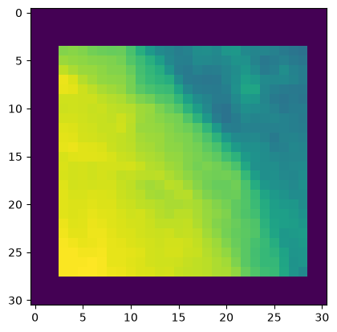

## Loading Gaze Patch Datasets

After conversion, we need to load the newly created gaze patch datasets into pytorch datasets.


```python
import fovealgat_confs as conf
```

### REFLACX


```python
from reflacx import ReflacxGazePatchDataset
```


```python
gaze_dataset_pth = conf.reflacx_gaze_dataset_pth
desired_label = 'Atelectasis'
```


```python
ds = ReflacxGazePatchDataset(gaze_dataset_pth, desired_label)
```


```python
fs, gsp, labels = ds[33]
```


```python
import matplotlib.pyplot as plt
```


```python
plt.imshow(gsp[13])
```


    <matplotlib.image.AxesImage at 0x702ee12f7150>


    

    


to make a data loader, we first need a collate function, as the gaze patch sequences vary in size


```python
from dataset_tools import gaze_patch_dataset_collate
```


```python
ls, fs, ps, labels = gaze_patch_dataset_collate((ds[33], ds[34], ds[0]))
```


```python
ls, sum(ls)
```


    ([47, 155, 53], 255)


```python
fs.shape, ps.shape, labels.shape
```


    (torch.Size([255, 3, 1, 1]), torch.Size([255, 1, 31, 31]), torch.Size([3]))


now for the DataLoader itself


```python
from torch.utils.data import DataLoader
```


```python
loader = DataLoader(ds,
                    batch_size=6,
                    collate_fn=gaze_patch_dataset_collate,
                    num_workers=4,
                    pin_memory=True)
```


```python
b = None
for batch in loader:
    b = batch
    break
```


```python
ls, fs, ps, labels = b
```


```python
ls, sum(ls)
```


    ([53, 95, 214, 335, 112, 89], 898)


```python
fs.shape, ps.shape, labels.shape
```


    (torch.Size([898, 3, 1, 1]), torch.Size([898, 1, 31, 31]), torch.Size([6]))


### MIMIC EYE (Not used in the publication)


```python
from matplotlib import pyplot as plt
```


```python
from mimic_eye import MimicEyeGazePatchDataset
```


```python
gaze_dataset_pth = conf.mimic_gaze_dataset_pth
desired_label = 'pneumonia'
```


```python
ds = MimicEyeGazePatchDataset(gaze_dataset_pth, desired_label)
```


```python
fs, gsp, labels = ds[33]
```


```python
fs.shape, gsp.shape, labels.shape
```


```python
plt.imshow(gsp[7])
```

now for the data loader, identical to the reflacx case


```python
from torch.utils.data import DataLoader

from dataset_tools import gaze_patch_dataset_collate
```


```python
loader = DataLoader(ds,
                    batch_size=6,
                    collate_fn=gaze_patch_dataset_collate,
                    num_workers=4,
                    pin_memory=True)
```


```python
b = None
for batch in loader:
    b = batch
    break
```


```python
ls, fs, ps, labels = b
```


```python
ls, sum(ls)
```


```python
fs.shape, ps.shape, labels.shape
```
